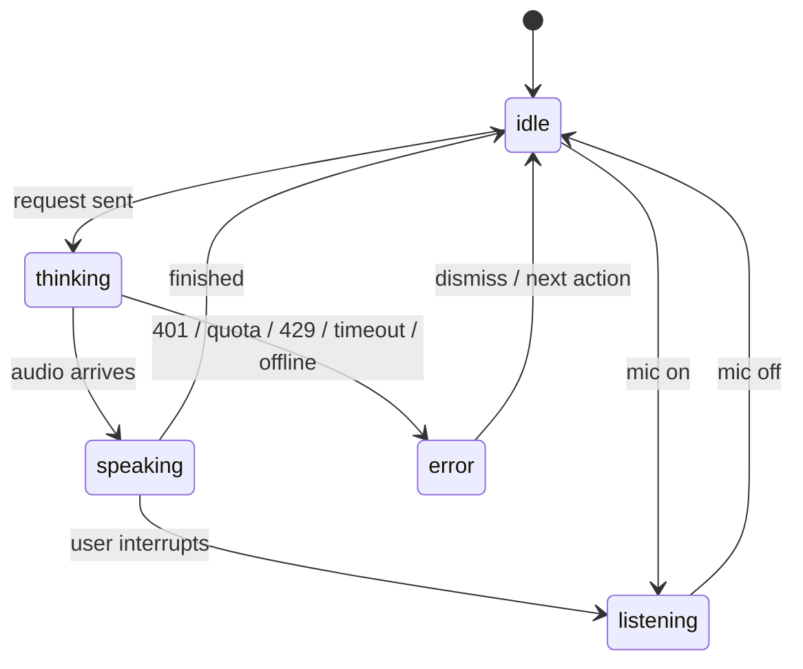

# Case study kit: Voice Studio

Working material for the "complex product or systems problem" case study.
Sections marked **[YOU]** need your own words, research and decisions.

> **Framing, kept honest.** Say only what's true about Slingshot. A safe, strong
> version: *"At Slingshot, Ash's voice experience used ElevenLabs, and the voice
> visual was a string that moves with speech. Tuning it was guesswork. I designed
> and built the internal tool I wished we'd had."* Only say the team used it, or
> that it changed what shipped, if that happened.

---

## 1. The problem

The string is the most visible part of Ash's voice experience. It's how users
know Ash is listening, thinking or speaking. But how it *feels* depends on a
system that nobody could see all at once:

- **Real audio is messy.** Whispers, shouting, fan noise, long pauses and fast
  talkers all hit the same visual. Mockups and motion files only show the ideal case.
- **The voice API has its own behavior.** Time before audio arrives, word timings,
  rate limits, running out of credits, timeouts. Each one is a state the string has to show.
- **Feel lives in numbers.** Tension, damping, gate, attack and release are
  engineering parameters. Designers can't tweak them, and engineers end up guessing.
- **Edge cases show up in production** instead of during design.

**The design question:** how do you give a team one place to see, tune and
stress-test a voice visual against real audio, a real API, and the conditions
that break it?

**[YOU]** Who exactly was this for (you, other designers, engineers, a PM)? What
moment made you want it? A specific bug or review is ideal.

---

## 2. Mapping the complexity

### 2a. The pipeline

```
 Source                 Signal processing                  The string
 ───────────────        ─────────────────────────────      ──────────────────────
 ElevenLabs TTS  ─┐
 Microphone      ─┼─▶  level ─▶ noise gate ─▶ attack/   ─▶  energy ─▶ spring physics
 Edge-case script ┘                             release        │      on N points
                                                               │          │
 Word timings (ElevenLabs alignment / speech recognition / script) ─▶ "pluck" ─┘
                                                                          │
 Session state (idle · listening · thinking · speaking · error) ─▶ color, motion, droop
```

Every source goes through the same pipeline. A scripted edge case and real
audio behave identically, so what you tune against a script carries over to live audio.

### 2b. String states



How each state looks, and why:

| State | Look | Reason |
|---|---|---|
| Idle | Slow breathing | Alive but not demanding attention |
| Listening | User's color (sage) | Shows whose turn it is without any text |
| Thinking | Wave travelling along the string | Shows progress; signals "I heard you" during API delay |
| Speaking | Ash's color (mauve), plucked on each word | Ties the motion to what's being said |
| Error | Desaturates, goes slack, sags | Reads as "unavailable", not "broken", and isn't alarming in a mental-health context |

### 2c. Parameter model

17 parameters in four groups, so they make sense to designers and engineers alike:

| Group | Parameters | Question they answer |
|---|---|---|
| Look | thickness, Ash color, user color, width, swell | What is it? |
| Shape | points, complexity, loopiness | How expressive is its form? |
| Motion | idle motion, speed, tension, damping | How does it move on its own? |
| Response | reactivity, noise gate, attack, release, word pluck | How does it react to voice? |

**Handoff:** "Copy as JSON" exports the exact numbers for engineering, and
presets can be saved and compared. That replaces "make it a bit bouncier" with
values both sides agree on.

### 2d. Edge-case inventory

| Edge case | What it tests | Parameter that solves it |
|---|---|---|
| Whisper | Is quiet speech visible at all? | Noise gate vs. reactivity trade-off |
| Shouting (clipping) | Does it stay in frame and stay calm? | Amplitude cap, swell, clipping indicator |
| Long pause mid-sentence | Does it look broken during silence? | Release, idle motion |
| Fast talker | Do word plucks turn into noise? | Pluck strength, damping |
| Background hum | Does it twitch with no speech? | Noise gate |
| User interrupts Ash | Is the turn change clear? | Color handover, state switch |
| Slow first audio | What does waiting look like? | Thinking state |
| Invalid key / out of credits / rate limited / timeout / offline | What does failure look like, and what does the user read? | Error state + copy |

### 2e. API integration decisions

| Decision | Why |
|---|---|
| `/text-to-speech/{voice}/with-timestamps` | Returns per-character timing, so the string can react to actual words, not just loudness |
| Model choice exposed (Flash vs. Multilingual) | The trade-off between delay and quality is a design decision, so show the delay |
| Time to audio measured on every request | The thinking state must be designed for real delays, not ideal ones |
| Responses cached by text + voice + settings | Tuning means replaying the same line many times, and credits cost money |
| 15s timeout with AbortController | A request that hangs must never leave the UI in "thinking" forever |
| Error taxonomy (401, quota, 429, 4xx, 5xx, network, decode) | Each failure needs different copy. Each card shows **product copy** (what the user reads) and **team detail** (what engineers need) |
| API key kept in the browser tab only | Never committed or logged. In production this would sit behind a backend proxy |
| Not streamed (yet) | Simpler and more reliable for a tuning tool. Streaming would cut time to first audio, so it's the next step |

---

## 3. Exploration and discarded directions

**[YOU]** Interviewers dig hardest here. Real ones to consider:
- **Your Flutter prototype with pre-recorded audio.** What it showed, and what it hid.
- **Loudness only vs. loudness + word plucks.** Loudness alone looked like a VU meter; plucks made it feel like speech.
- **Separate visuals for Ash and the user vs. one string that changes color.** One string keeps the conversation feeling shared.
- **Error as red or shaking vs. slack and grey.** Red reads as alarming, which is wrong for a mental-health product.
- **Exposing every physics variable vs. 17 grouped ones.** What you cut and why.
- **[YOU]** Any sketches, motion studies or Figma explorations.

---

## 4. Research and validation (next 2 days)

A short round makes this much stronger. Be upfront that it was quick.

**With 2–3 designers or engineers (tool usability):**
1. "Make the string feel calmer when Ash speaks." Watch which parameters they reach for.
2. "Make sure a whisper still registers." Do they find the noise gate?
3. Show the error cases. Ask: "Is it clear what happened, and what the user would see?"

**With 3–4 potential users (does the string communicate?):**
1. Play Calm reply, Listening, Thinking and Error with no labels. Ask: "What's happening?"
2. Play User interrupts Ash. Ask: "Whose turn is it now?"
3. Compare two presets. Ask: "Which feels more like someone listening to you?"

**[YOU]** Findings, quotes, and at least one before/after change.

---

## 5. Where it landed

**[YOU]** What's built, what you learned, what's unsolved (streaming, the backend
key proxy, per-word confidence from speech-to-text, mobile performance in
Flutter), and what you'd do differently.

---

## 6. 20-minute outline

| Time | Section | Show |
|---|---|---|
| 0–3 | Context and problem | Ash's string; why tuning was guesswork |
| 3–8 | Mapping the complexity | Pipeline, state diagram, parameter groups, edge-case table |
| 8–12 | Exploration | 2–3 directions and why they were dropped or kept |
| 12–15 | Testing and iteration | Quotes + one before/after |
| 15–20 | Live demo and where it landed | ElevenLabs line → interrupt → out of credits → tweak a parameter → Copy as JSON |

**Demo tips:** set up the key and connect beforehand. Speak once before the interview so
the line is cached (instant, no credits). If the API misbehaves live, that's
a chance to show the error handling.

The Transcript lab (`transcript.html`) is a companion tool covering the
speech-to-text side (partial words, revisions, confidence). It's useful backup if they ask about the listening side.
