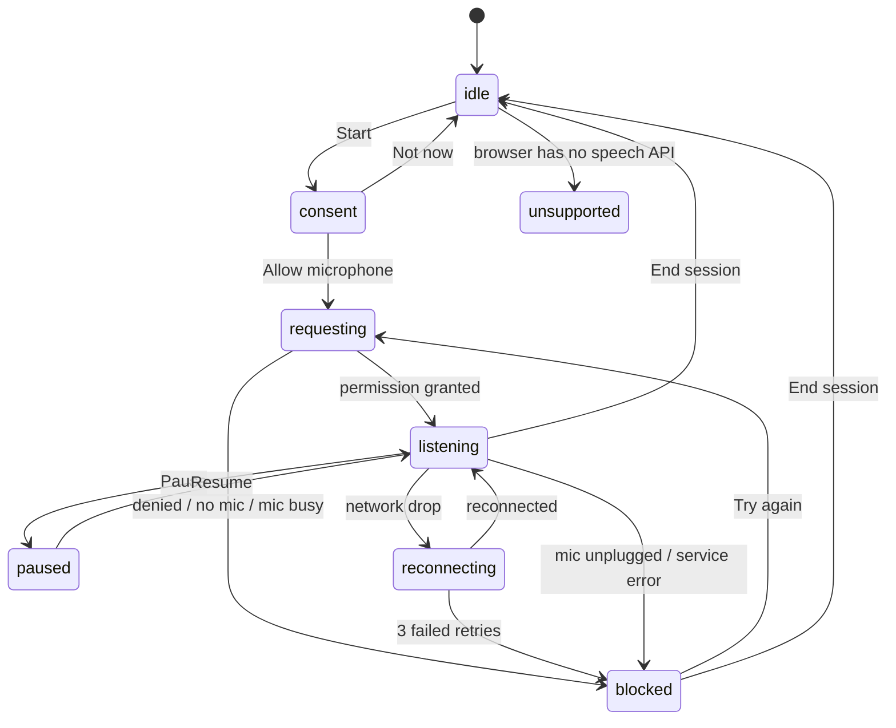

# Case study kit: Voice Visualizer

Working material for the "complex product or systems problem" case study.
Sections marked **[YOU]** need your own words, research and decisions. Don't
present anything here as research you didn't do.

---

## 1. The problem (draft, rewrite in your voice)

Live speech-to-text looks simple: audio goes in, words come out. In practice,
what the user reads is changing all the time:

- Words appear **before they're final** and get **rewritten** as the service hears more.
- The service is **sometimes unsure**, but a confident-looking UI hides that.
- The pipeline **depends on things the user can't see**: mic permission, the right
  device, a network connection to a remote speech service, a supported language.
- Every one of those can **fail mid-sentence**.

**The design question:** how do you make an unstable, uncertain stream of speech
readable and trustworthy, and stay honest when the system fails?

**[YOU]** Who is it for? Pick one primary user and say why. For example: someone
reviewing a conversation afterwards, a person who is hard of hearing following
live speech, or someone taking notes in a meeting.

**[YOU]** How did the project start? (Flutter prototype with pre-recorded audio,
then realizing pre-recorded audio hid all the hard parts.) That's an honest and
strong opening.

---

## 2. Mapping the complexity

### 2a. Session state machine

The core artifact. Every screen state in the app comes from this diagram, and
the System inspector shows these transitions live.

Things to say about it:
- **`consent` is a state I added on purpose.** The browser's permission prompt
  gives no context and you only get one clean shot at it. A denied prompt is hard
  to undo, so the app explains first, then triggers the browser prompt.
- **`reconnecting` is not an error state.** The session continues and the
  transcript stays. Only after 3 failed retries (1s, 2s, 4s back-off) does it
  become `blocked`.
- **`blocked` always comes with a specific reason and a next step.** No generic
  "something went wrong".

### 2b. Edge-case inventory

| Situation | What the system sees | What the user sees | Scenario to demo it |
|---|---|---|---|
| Normal speech | Partial results, then final | Grey words with a cursor, settling into dark text | Happy path |
| Service changes its mind | Partial text rewritten | Rewritten words flash briefly, then settle | Self-correcting transcript |
| Mumbled or noisy speech | Final result, low confidence | Dotted underline + "Check this · 46%" tag; threshold adjustable | Low confidence |
| Network drop mid-sentence | `network` error | Unfinished phrase kept and tagged "Cut off"; amber banner; gap marked in transcript and ribbon | Network drop |
| Network never recovers | 3 failed retries | Specific explanation, transcript kept, Try again | Network fails for good |
| Mic unplugged | Audio track `ended` | Phrase kept as "Cut off · mic disconnected"; reconnect prompt | Mic unplugged |
| Permission denied | `NotAllowedError` | How to fix it in the browser + option to explore with a scenario | Permission denied |
| Mic on, nothing heard | Low loudness for 6s | Gentle hint to check the mic; session not interrupted | Long silence |
| No mic found / mic busy | `NotFoundError` / `NotReadableError` | Specific message for each | (live only) |
| Unsupported browser | No speech API | Explains which browsers work; offers scenarios | (Firefox) |
| Language not supported | `language-not-supported` | Points to the language setting | (live only) |
| Service ends its session | `onend` with no error | Nothing: it restarts silently, unfinished phrase saved | (live only) |

### 2c. Data model

What one transcribed phrase carries, and how each field becomes something visible:

| Field | Meaning | Becomes |
|---|---|---|
| `text` | The words | Transcript text |
| `isFinal` | Will the service still change it? | Grey + cursor vs. settled |
| `revisions` | Times the service rewrote it | Flash on changed words; inspector count |
| `confidence` | 0–1 from the service; `null` if not reported | Dotted underline + tag below threshold |
| `t0`, `t1` | When it started and ended | Timestamp; band under the loudness ribbon |
| `words[].level` | Loudness while each word was spoken | Font weight and opacity of each word |
| `interrupted` | `network`, `mic-lost`, or a normal stop | "Cut off" tag + ellipsis |

Plus session-level data: loudness samples (20/s), reconnect gaps, and the
transition log. Export as `.json` from the inspector to show this concretely.

### 2d. Constraints log: what the API forced

You were both the designer and the engineer here, so this is your "working with
engineering" story: how technical limits shaped design decisions.

| Constraint | Design consequence |
|---|---|
| Confidence is per **phrase**, not per word | Mark the whole phrase, not individual words. Don't pretend to more precision than the data has |
| Some engines report confidence `0` meaning "unknown" | Treat 0 as "not reported", never as "0% confident" |
| No word timings | Loudness per word is approximated by splitting the phrase's audio evenly. Present it as expressive, not exact |
| Service ends sessions by itself after silence or time limits | Auto-restart, and save the unfinished phrase so it isn't lost |
| Audio during a network drop is lost, not queued | Say so in the banner and mark the gap; don't imply nothing was said |
| Audio goes to Google (Chrome) or Apple (Safari) | Disclose it before asking for the mic |
| Browser permission prompt can't be styled or explained | Add a pre-permission explainer state |
| Only Chromium browsers and Safari support it | Scenario mode works everywhere, so the experience can still be explored |

---

## 3. Exploration and discarded directions

**[YOU]** This is where interviewers dig hardest. Use what really happened.
Prompts to help you remember or try things:

- **Pre-recorded audio (your Flutter version).** What did it show you? What did it
  hide? This is a real discarded approach.
- **Showing partial words vs. waiting for finals.** Waiting is calmer but feels
  laggy; showing them is responsive but jumpy. Current answer: show them in grey,
  and flash only the words that change. There's a toggle to compare both.
- **Marking low confidence per word vs. per phrase vs. hiding it.** (See the constraints log.)
- **What happens to the unfinished phrase on a network drop.** Discard it, keep
  it silently, or keep and tag it? Current: keep and tag.
- **Loudness as a separate waveform only vs. in the text itself.** The ribbon shows
  the audio; font weight brings it into the words.
- **[YOU]** Sketches or directions you tried in Figma that didn't make it.

---

## 4. Research and validation: plan for the next 2 days

Even 4–5 short sessions give you real material. Be upfront that this was a
quick round.

**Setup:** deployed link, Chrome, a quiet-ish room. 10–15 minutes each.

**Script:**
1. "Talk for a minute about your plans this weekend." Watch: do they look at the
   text or at you? Do they notice the rewrites?
2. Play **Self-correcting transcript**. Ask: "What just happened there? Did that bother you?"
3. Play **Low confidence**. Ask: "What does the underline mean to you? What would you do about it?"
4. Play **Network drop**. Ask: "What do you think happened? Do you trust the
   transcript after this point?"
5. Toggle "Show words as they're heard" off and on. Ask: "Which do you prefer and why?"
6. "If you used this for real, what would you use it for?"

**Capture:** quotes, moments of confusion, and anything you change because of it.
Keep one or two "before / after" changes. They are the most convincing evidence.

**[YOU]** Findings and what you changed.

---

## 5. Where it landed

**[YOU]**
- What's built (live mode + 8 scenarios; demo it).
- What users told you and what changed.
- What's unsolved: speaker separation, per-word confidence, storing sessions,
  mobile (back to Flutter?).
- What you'd do differently.

---

## 6. 20-minute outline

| Time | Section | Show |
|---|---|---|
| 0–3 | Problem and why pre-recorded audio misled you | Old Flutter prototype vs. the live stream |
| 3–8 | Mapping the complexity | State diagram, edge-case inventory, constraints log |
| 8–12 | Exploration | 2–3 directions and why each was dropped or kept |
| 12–16 | Testing and iteration | Quotes + one before/after change |
| 16–20 | Demo and where it landed | Live mic, then Network drop and Low confidence scenarios; what's next |

**Demo tips:** have the inspector visible so the state changes are obvious. Start
live for 20 seconds, then switch to scenarios. If the live mic misbehaves in the
interview, that's itself a chance to show the error handling.

**Be clear about scope:** a solo project. You designed it and built it, and you
used AI as a coding partner. Say how. Interviewers care more about honest
scope than impressive scope.
